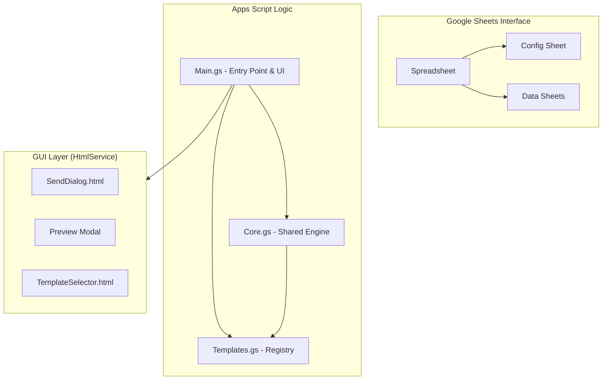

# Architecture

> Updated: 2026-02-26 (Post-Unification v2.0)

## Overview

The system follows a **Unified Core Engine** architecture. Instead of multiple independent scripts, it uses a shared engine that dynamically resolves behavior based on a **Template Registry**.

## Core Components

### 1. Engine (`Core.gs`)
- **Shared Utilities**: Sheet reading, header mapping, status tracking, Drive file sharing.
- **Batch Processor**: `sendBatch` / `_executeBatch` orchestrates the loop, skipping sent rows and handling quotas.
- **Base Layout**: Provides the institutional HTML template (PUCV branding) that wraps all content.
- **Menu Builder**: Supports nested submenus for a clean user interface.

### 2. Template Registry (`Templates.gs`)
- **Registry Pattern**: Each campaign (Certificates, Surveys, etc.) is registered as an object.
- **Components**:
    - `id`: Unique identifier.
    - `requiredHeaders`: Columns the template needs.
    - `processRow`: Data transformation logic (logic switch).
    - `buildHtml`: Content builder for the specific email body.
- **Templates**: `certificate`, `confirmation`, `payment_reminder`, `placement_test`, `code_delivery`, `report_delivery`, `survey`.

### 3. Entry Point & UI (`Main.gs`)
- **UI Integration**: Handles `onOpen` menus and HtmlService dialogs.
- **Config Loader**: Reads global settings (template_id, data_sheet, cc/bcc) from the "Config" sheet.
- **Setup**: Orchestrates auto-sheet generation for new campaigns.

## User Interface (GUI)

- **Menú PUCV**: Categorized into "Envío" and "Herramientas".
- **Send Customizer**: HTML dialog to override Subject, CC/BCC, and Extra Note per send.
- **Visual Preview**: Full-screen modal to review final emails before broadcasting.

## Data Flow

1. **Initialize**: `menuSetupTemplate` creates the necessary sheets for a specific template.
2. **Configure**: User fills out "Config" and populates "Data" sheets.
3. **Trigger**: User selects "Enviar Correos" or "Crear Borradores".
4. **Customize**: `SendDialog` appears for final adjustments.
5. **Process**: Engine iterates through data sheet, calls `Templates.gs` to build unique HTML per row, and sends via Gmail.
6. **Track**: Status columns are updated in real-time.
